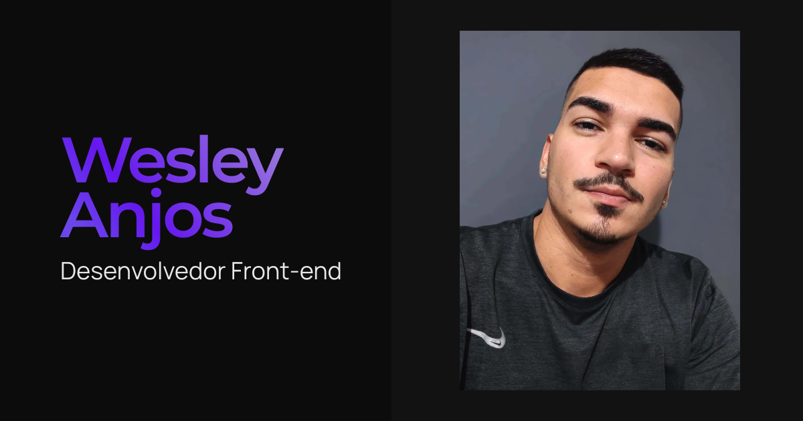

<h1 align="center">
  
</h1>

<h1 align="center">
  Portfólio - Wesley Anjos
</h1>

## 📃 Sobre

Landing Page desenvolvida com propósito de compartilhar meus trabalhos de desenvolvimento web, trabalhos realizado junto a empresa e freelancer.

## 🚀 Tecnologias e Metodologia utilizadas

- Next.js
- SASS
- Atomic Design
- DatoCMS
- GraphQL
- GSAP

## Ambiente local

Use Node.js 24 LTS e npm. Confirme a versão de Node no ambiente de hospedagem
antes de publicar. Instale as dependências com:

```sh
nvm use
npm ci
```

Crie `.env.local` com o endpoint GraphQL e um token de leitura do DatoCMS:

```dotenv
BASE_ENDPOINT=https://graphql.datocms.com/
DATO_TOKEN=seu-token
```

Não versione o token. Para iniciar o servidor de desenvolvimento, execute
`npm run dev`. Para gerar a versão de produção, execute `npm run build` com
endpoint e token válidos; depois use `npm start`.

Execute `npm run lint` e `npm run prettier` para validar o código. Use
`npm run lint:fix` e `npm run prettier:fix` para aplicar correções automáticas.

ESLint permanece na versão 9 porque `eslint-plugin-import` ainda não declara
compatibilidade com a versão 10. Revise essa limitação ao atualizar os plugins.
